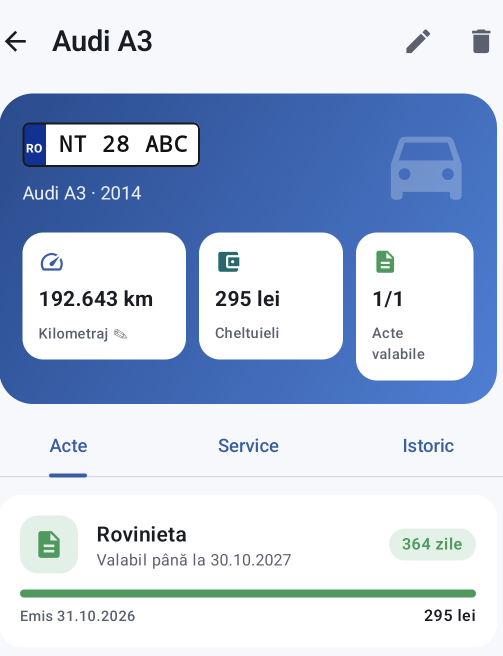

# Car Manager

Aplicație Android pentru gestionarea mașinilor personale. Ține evidența actelor (RCA, ITP, rovinietă, CASCO etc.) și a intervențiilor de service (schimb de ulei, revizie, plăcuțe de frână etc.), calculează când urmează următoarea mentenanță și trimite notificări înainte ca un act să expire sau ca o intervenție să devină scadentă.

Scopul aplicației este ca utilizatorul să știe în orice moment ce acte are valabile, ce a făcut la mașină și ce urmează să facă.

<p align="center">
  
</p>

## Funcționalități

**Ecranul principal (Garajul meu)**
- Un banner de stare care arată dacă totul e în regulă, dacă un act expiră în următoarele 30 de zile sau dacă un act a expirat deja.
- Lista actelor care necesită atenție, pentru toate mașinile.
- Lista mașinilor, cu numărul de înmatriculare, kilometrajul și starea fiecăreia.

**Ecranul unei mașini**
- Card cu numărul de înmatriculare, kilometrajul curent (se poate actualiza direct de aici), totalul cheltuielilor și câte acte sunt valabile.
- Tab-ul **Acte**: fiecare act cu data expirării, zilele rămase și o bară care arată cât a mai rămas din perioada de valabilitate.
- Tab-ul **Service**: secțiunea „Ce urmează”, cu următoarele intervenții estimate, și lista intervențiilor efectuate.
- Tab-ul **Istoric**: toate actele și intervențiile în ordine cronologică, grupate pe ani, cu totalul cheltuit.

**Formulare**
- Adăugare și editare pentru mașini, acte și intervenții.
- Sugestii rapide pentru tipurile uzuale (RCA, ITP, Rovinietă, Schimb ulei, Revizie etc.).
- Data de expirare se completează automat în funcție de tipul actului și poate fi ajustată cu butoanele „1 lună”, „6 luni”, „1 an”, „2 ani” sau din calendar.
- La o intervenție nouă, kilometrajul este precompletat cu cel actual al mașinii.
- Validări: data expirării nu poate fi înaintea datei emiterii, kilometrajul nu poate scădea, numărul de înmatriculare trebuie să fie unic.

**Notificări**
- O dată pe zi, aplicația verifică în fundal actele și intervențiile și trimite notificări.
- Pentru acte, notificările se trimit la 30, 7, 3 și 1 zile înainte de expirare, în ziua expirării și după ce actul a expirat. Fiecare prag este anunțat o singură dată.
- Pentru service, utilizatorul este anunțat când o intervenție se apropie de scadență sau a depășit-o.

## Tehnologii

| Domeniu | Tehnologie |
|---|---|
| Limbaj | Kotlin |
| Interfață | Jetpack Compose, Material 3 |
| Navigare | Navigation Compose (rute tipizate cu Kotlin Serialization) |
| Arhitectură | MVVM: ViewModel + StateFlow, Kotlin Coroutines |
| Comunicare cu serverul | Retrofit, OkHttp |
| Serializare JSON | Kotlinx Serialization |
| Sarcini în fundal | WorkManager |
| Date calendaristice | java.time |
| Teste | JUnit 4 |
| Build | Gradle (Kotlin DSL), Android Gradle Plugin, version catalog (`gradle/libs.versions.toml`) |

Cerințe Android: minim Android 8.0 (API 26), target API 37.

## Arhitectură

Aplicația nu stochează date local. Toate datele se află pe un backend separat (FastAPI + PostgreSQL, găzduit pe Render), iar aplicația comunică cu el printr-un API REST.

```
+---------------------+        HTTPS / JSON         +----------------------+
|  Aplicația Android  |  -------------------------> |  Backend FastAPI     |
|  (Compose, MVVM)    |   header X-API-Key          |  (Render)            |
+---------------------+  <-------------------------  +----------+-----------+
          |                                                     |
          | WorkManager (zilnic)                                v
          v                                          +----------------------+
   Notificări locale                                 |  PostgreSQL          |
                                                     +----------------------+
```

Fluxul datelor în aplicație:

1. **Ecranul** (Composable) afișează starea primită de la ViewModel și îi transmite acțiunile utilizatorului.
2. **ViewModel-ul** apelează API-ul prin Retrofit în corutine și expune rezultatul ca stare (`StateFlow` sau `mutableStateOf`).
3. **Logica de domeniu** (`domain/Reminders.kt`) calculează starea actelor și scadențele de service. Este cod Kotlin pur, fără dependențe Android, și este acoperit de teste unitare.
4. La revenirea pe un ecran, datele se reîncarcă automat, astfel încât modificările făcute într-un formular apar imediat.

### Calculul mentenanței

Backend-ul salvează doar intervențiile efectuate (titlu, dată, kilometraj, preț). Intervalele recomandate sunt definite în aplicație, în `domain/Reminders.kt`:

| Intervenție | Interval |
|---|---|
| Schimb ulei | 15.000 km sau 12 luni |
| Revizie | 15.000 km sau 12 luni |
| Plăcuțe frână | 30.000 km |
| Lichid frână | 24 de luni |
| Kit distribuție | 90.000 km sau 60 de luni |
| Antigel | 36 de luni |

Pentru fiecare tip, aplicația caută ultima intervenție după titlu (fără să țină cont de majuscule sau diacritice, de exemplu „Plăcuțe frână față” este recunoscut ca „Plăcuțe frână”). Apoi calculează următoarea scadență ca kilometrajul ultimei intervenții plus intervalul de km, respectiv data ultimei intervenții plus intervalul de timp, și ia în considerare termenul care vine primul. O intervenție este marcată „curând” când mai sunt cel mult 1.000 km sau 30 de zile, și „depășită” când termenul a trecut.

## Structura proiectului

```
app/src/main/java/com/example/carmanager/
├── CarManagerApp.kt            Clasa Application: creează canalul de notificări și programează verificarea zilnică
├── MainActivity.kt             Punctul de intrare, navigarea între ecrane, cererea permisiunii de notificări
├── data/
│   ├── Models.kt               Modelele de date (mașină, act, intervenție, costuri), identice cu cele din backend
│   └── CarApi.kt               Definiția API-ului (Retrofit), clientul HTTP și traducerea erorilor în mesaje clare
├── domain/
│   └── Reminders.kt            Starea actelor, regulile și calculul scadențelor de service
├── notifications/
│   └── ReminderWorker.kt       Verificarea zilnică din fundal și trimiterea notificărilor
└── ui/
    ├── Routes.kt               Rutele de navigare
    ├── Format.kt               Formatarea datelor, sumelor și kilometrilor (format românesc)
    ├── home/                   Ecranul principal
    ├── car/                    Ecranul unei mașini (Acte, Service, Istoric)
    ├── forms/                  Formularele pentru mașini, acte și intervenții
    ├── components/             Componente reutilizabile (plăcuța de înmatriculare, carduri, câmpuri)
    └── theme/                  Culori, temă (mod luminos și întunecat), tipografie

app/src/test/java/.../domain/RemindersTest.kt   Teste unitare pentru logica de remindere
```

## API folosit

Aplicația folosește următoarele endpoint-uri ale backend-ului. Toate, cu excepția `/health`, cer header-ul `X-API-Key`.

| Metodă | Endpoint | Utilizare |
|---|---|---|
| GET / POST | `/cars` | Lista mașinilor, adăugare mașină |
| GET / PATCH / DELETE | `/cars/{id}` | Detalii, editare, ștergere mașină |
| GET | `/cars/{id}/costs` | Totalul cheltuielilor |
| GET / POST | `/cars/{id}/documents` | Actele unei mașini, adăugare act |
| PUT / DELETE | `/documents/{id}` | Editare, ștergere act |
| GET | `/documents/expiring?days=30` | Actele care expiră curând (toate mașinile) |
| GET / POST | `/cars/{id}/maintenance` | Intervențiile unei mașini, adăugare intervenție |
| PUT / DELETE | `/maintenance/{id}` | Editare, ștergere intervenție |

## Configurare și rulare

1. Deschide proiectul în Android Studio.
2. În fișierul `local.properties` din rădăcina proiectului adaugă adresa backend-ului și cheia API:

   ```properties
   carApi.url=https://car-manager-api.onrender.com/
   carApi.key=CHEIA_TA_API
   ```

   Cheia este valoarea variabilei `API_KEY` din setările serviciului pe Render. Fișierul `local.properties` nu este inclus în git, astfel încât cheia nu ajunge în repository. La build, valorile sunt transmise aplicației prin `BuildConfig`.

3. Rulează aplicația pe un emulator sau pe un telefon (butonul Run din Android Studio), sau din terminal:

   ```bash
   ./gradlew :app:installDebug
   ```

Observație: pe planul gratuit Render serviciul intră în repaus după o perioadă de inactivitate, așa că prima cerere poate dura până la un minut. Aplicația afișează un mesaj de încărcare în acest timp.

## Testare

Testele unitare pentru logica de remindere:

```bash
./gradlew :app:testDebugUnitTest
```

Pentru a verifica notificările fără să aștepți verificarea zilnică, în build-ul de debug poți porni verificarea imediat:

```bash
adb shell am start -n com.example.carmanager/.MainActivity --ez runReminders true
```

## Limitări cunoscute

- Nu există conturi de utilizator. Toți cei care folosesc aceeași instanță a backend-ului văd aceleași mașini.
- Cheia API este inclusă în aplicația compilată și poate fi extrasă din ea. Pentru o aplicație publică, următorul pas ar fi autentificarea utilizatorilor (de exemplu cu token-uri JWT) și asocierea mașinilor cu fiecare cont.
- Aplicația necesită conexiune la internet. Datele nu sunt disponibile offline.
- Intervalele de mentenanță sunt valori standard, aceleași pentru toate mașinile.
